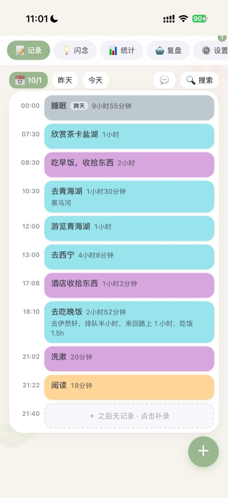
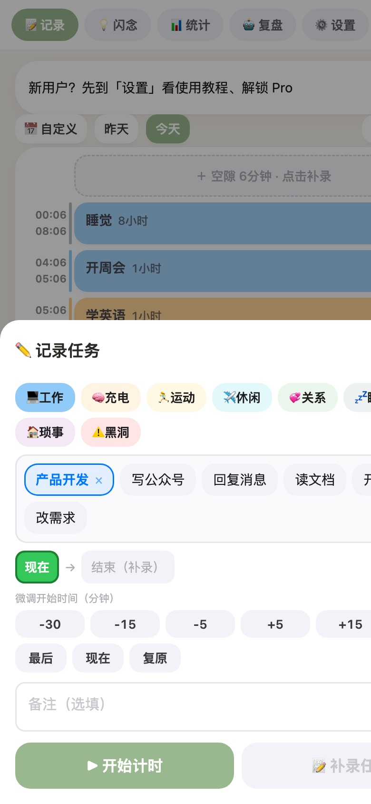
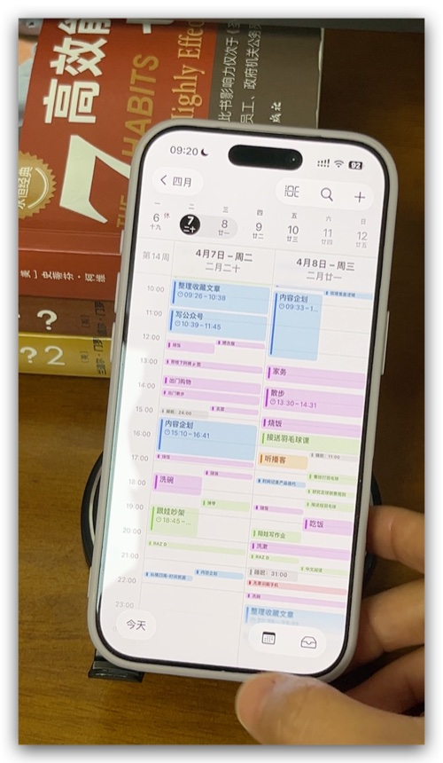
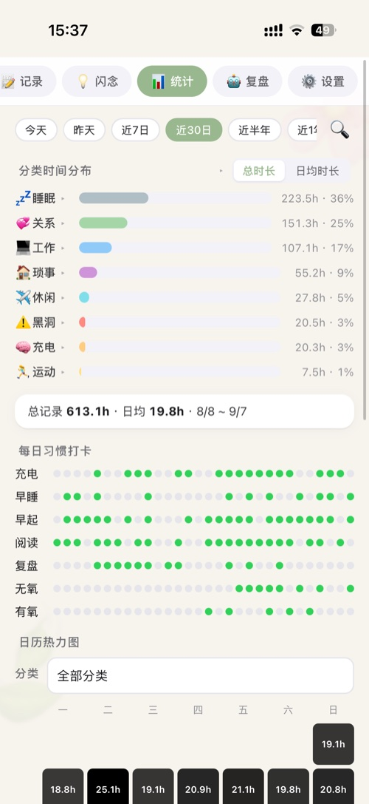
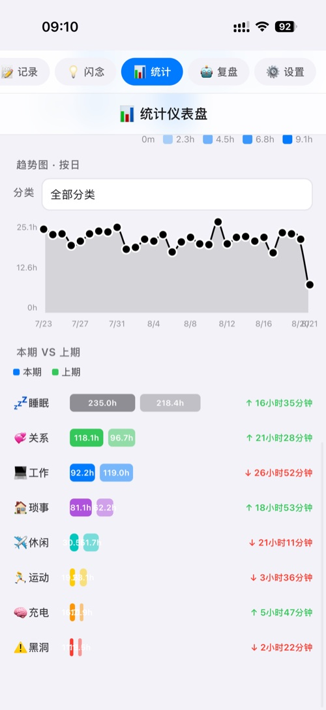
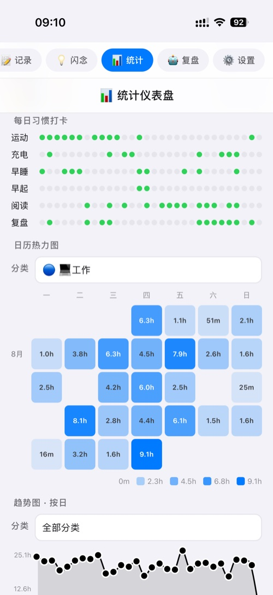
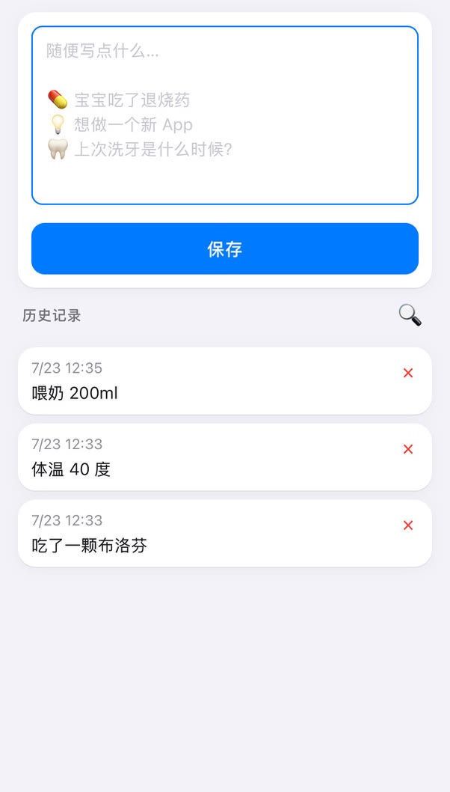
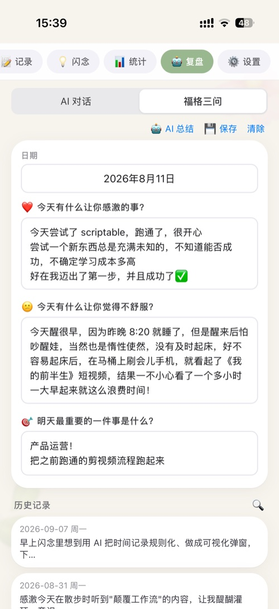
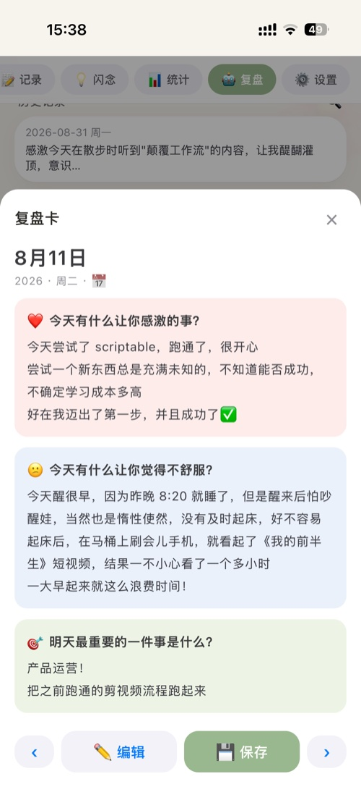
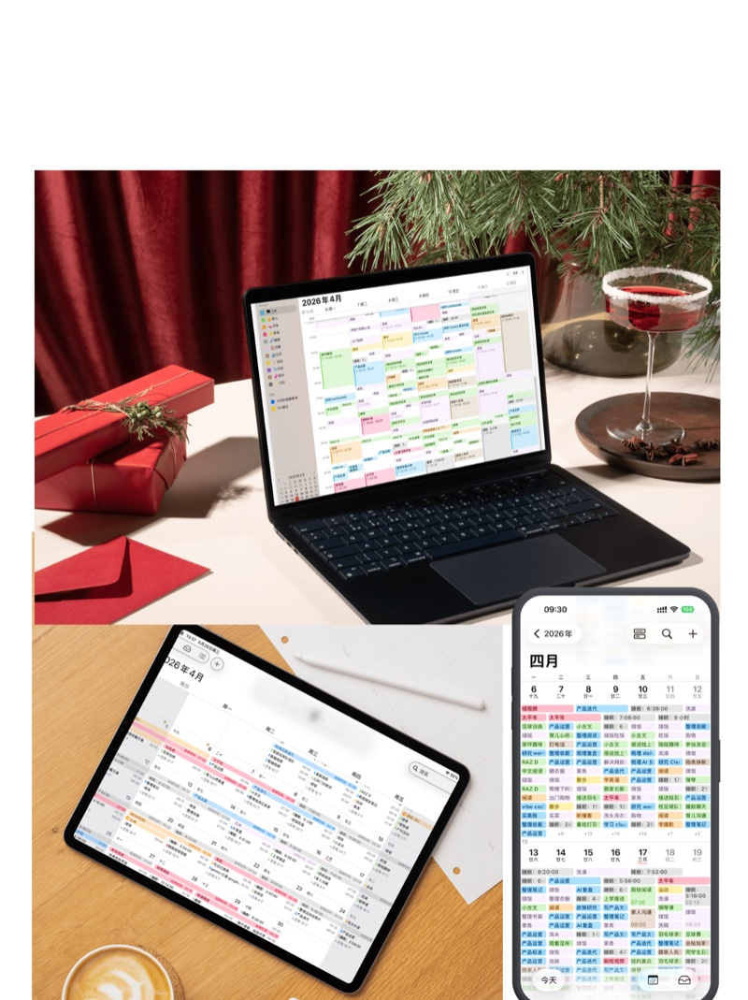

# 时间记录工具 Time Tracking

> 柳比歇夫式个人时间记录网页应用：记下每件事的起止时间，自动生成时间流和统计。打开即用，数据全部保存在本地。

**在线体验**：<https://time-tracking.echosaiagent.com>
（手机浏览器打开，添加到主屏幕后可像原生 App 一样使用）

---

## 功能一览

### 📝 时间流记录

 

任务按发生顺序逐行排列，标题、时长、备注完整显示；
点选式记录弹窗：分类胶囊下直接点历史任务 chips（按最近使用排序），标题和分类一次带出，全程不用打字；
开始/结束时间一行展示，点选端点后 ±5/±15/±30 分钟快捷微调；
右下角悬浮按钮随时【开始（＋）】/ 【结束（■）】；
点【空隙行】补录空白时段。

数据保存在本地浏览器，别担心数据丢失，会自动同步到苹果日历（Pro）。实现2种视图：浏览器中查看任务列表；日历中查看时间块。

### 📊 统计

 

日 / 周 / 月时间分布，分类占比，相近任务名自动合并（×N），趋势图、热力图；任务明细可点开直接编辑。

### ⏰ 习惯打卡

自定义每日习惯，当天记录包含习惯名即自动打卡；内置早睡 / 早起阈值打卡；日历热力图按分类查看。

### 💡 闪念

随手记想法、备忘、灵感，纯本地保存；历史记录按时间轴回顾。

### 🤖 复盘

 

福格三问复盘框架，支持 AI 按当天记录起草初稿（Pro）；保存为复盘卡，历史记录可按日期翻阅。

### 📓 导出

JSON 全量备份 / 导入合并；一键生成 Obsidian 日记（时间流 + 时间统计 + 习惯打卡）；苹果日历同步（Pro），Mac / iPad / iPhone 多端可看。

## 快速开始

1. 打开 <https://time-tracking.echosaiagent.com>
2. 进入「📝 记录」页，点右下角绿色 ＋
3. 从分类下点选历史任务（或输入新任务），确认时间即开始计时；点红色 ■ 打开结束弹窗

## 数据说明

- 所有数据保存在浏览器本地（localStorage），不上传服务器，无需注册账号
- 清除浏览器数据或换设备会丢失数据，建议定期用「设置 → 导出数据」备份
- 换设备迁移：旧设备导出 JSON → 新设备导入

## 自行部署

纯静态、零依赖、零构建，整个应用就是一个 `index.html`。

**下载**：点本页右上方绿色「Code」按钮 →「Download ZIP」，解压即得全部文件（无需逐个下载）；熟悉 git 的话也可以 `git clone`。

**部署**（任选其一）：

| 方式 | 步骤 |
|------|------|
| GitHub Pages（零下载） | Fork 本仓库 → 仓库 Settings → Pages → Source 选 `main` 分支，几分钟后访问 `你的用户名.github.io/time-tracking` |
| Cloudflare Pages | Pages 控制台直接拖拽上传解压后的文件夹，配域名即可（`_worker.js` 用于 SPA 路由兜底） |
| 其他静态托管 | 上传 `index.html` 和两个 `pwa-icon` 图标即可，`_worker.js` 可忽略 |

也可以不部署：解压后直接双击 `index.html` 就能在浏览器里用（数据保存在浏览器本地）。

## 技术说明

- 单文件应用：所有页面、业务逻辑、样式都在 `index.html` 内
- 数据层：浏览器 localStorage，无后端
- Pro 功能（苹果日历同步、桌面小组件、AI 复盘）依赖作者自建的 Cloudflare Worker 鉴权服务，自行部署时不包含这部分，其余功能完整可用

## 常见问题

**Q：为什么添加到主屏幕没有图标？**
A：请使用支持 PWA 的浏览器（Safari、Chrome、Edge 等），并确保网络可以访问图标文件。

**Q：Pro 功能是什么？**
A：Pro 功能包括苹果日历同步、桌面小组件、AI 复盘对话、福格三问 AI 总结，需要在设置页输入小红书订单号解锁。
